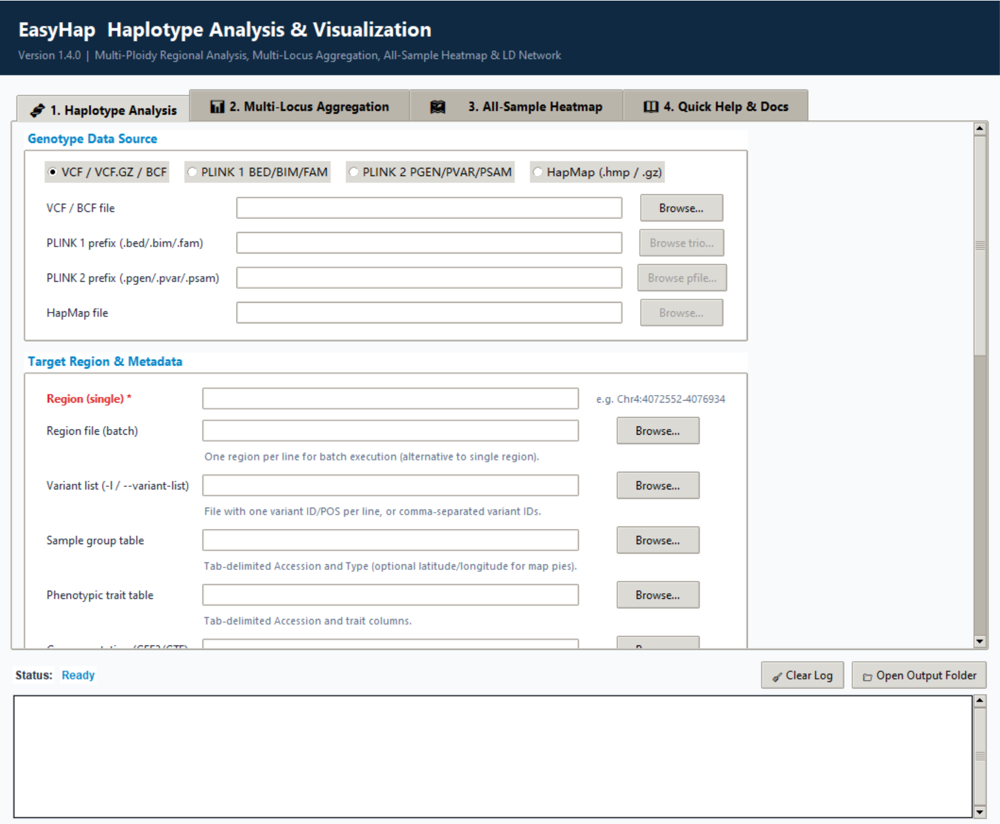
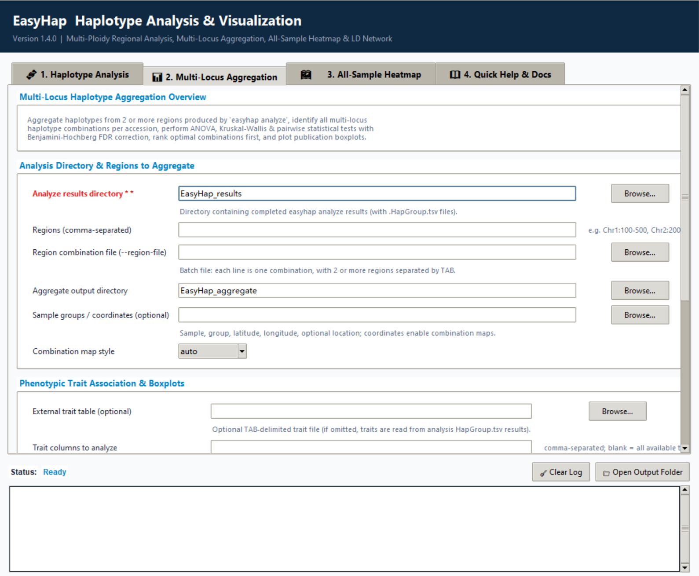
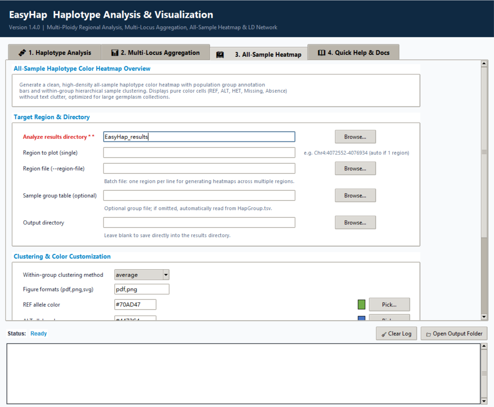

<p align="center"></p>

EasyHap reads regional genotypes, constructs phase-independent genotype categories or known-phase chromosome-copy haplotypes, and produces descriptive statistics and figures. `aggregate` compares combinations of categories from multiple regions with numeric phenotypes.

## Citation

He Guangqi and Shou Huixia. 2026. “EasyHap: A Ploidy-Aware Toolkit for Haplotype Analysis, Visualization, and Favorable Allele Discovery.” *Crop Design* 5 (2): 100167. https://doi.org/10.1016/j.cropd.2026.100167.

## Key features

- **Four input families:** VCF/VCF.GZ/BCF, PLINK 1 BED/BIM/FAM, PLINK 2 PGEN/PVAR/PSAM, and HapMap; one genotype source per run.
- **Phase-aware semantics:** default phase-independent `genotype` mode; `copy` mode for genuinely phased chromosome copies, with ploidy/phase-set validation.
- **Targeted regional or variant-list analysis:** indexed variant retrieval where supported, variant QC (`--max-missing`, `--min-maf`), annotation-based selection, optional Fisher filtering and parallel batch analysis.
- **Genetic and population summaries:** class reconstruction, diversity, private haplotypes, sequence-similarity clustering, LD, sequence-state exports and overlap/structural-absence audits.
- **Phenotype analysis:** trait association and descriptive superior-haplotype candidates with a shared `--plot-min-count` eligibility threshold in the current development build.
- **Multi-region workflows:** `easyhap aggregate` with trait-specific direction, multiple-testing correction, optional connection of *known* phased copies, and an exploratory two-region interaction model.
- **Publication-ready figures:** haplotype + gene-structure panels, group composition, trait boxplots, LD heatmaps, maps, networks and a new all-sample `easyhap heatmap` command.
- **Cross-platform delivery:** CLI and GUI; Windows builds can bundle `bcftools` and `plink2` executables to avoid compiling `pgenlib` on Windows.

## Recent additions and refinements (October 2026)

| Area | Summary |
|---|---|
| Expanded inputs | `--pfile`, `--hmp`, indexed and backend-selectable VCF/BCF reading, plus portable Windows PLINK/BCF tools |
| Targeted filtering | `--variant-list` (`-l`, `--var-list`), `--max-missing`, `--min-maf`, `--fisher-test` (`allele` or `carrier`), and multi-process `--threads` |
| Downstream commands | `easyhap aggregate` and `easyhap heatmap` |
| Multi-region interpretation | Descriptive candidate ranking, BH-adjusted trait comparisons, optional `--phase-link` and `--interaction` |
| Cleaner analyze outputs | Keep the effective `.SampleGenotypeTokens.tsv` only; apply `--plot-min-count` to both trait tests and superior-haplotype candidates as well as displayed classes |
| Figure polish | Compact gene-structure/heatmap connector spacing and consistent allele/class colors |

**Note:** `aggregate --min-count`, `--test-min-count` and `--candidate-min-count` are intentionally **independent** thresholds. Do not confuse them with the shared `analyze --plot-min-count` threshold.

## Install and run

Python 3.9+ is required. Linux source installation:

```bash
unzip EasyHap_v1.4.0_Linux.zip
cd EasyHap_v1.4.0_Linux
python -m pip install -e .
easyhap --version
easyhap analyze --help
easyhap aggregate --help
```

The dependencies include NumPy, pandas, SciPy, matplotlib, networkx, pysam, cyvcf2, and pgenlib. Tkinter must be installed separately by the operating system if it is absent. Start the graphical interface with `easyhap-gui` or `python easyhap_gui.py`. On Linux, `pgenlib` can be used for direct PGEN reading where available. In the updated cross-platform reader, an installed PLINK/PLINK2 executable may instead be used for region-limited PLINK-to-VCF conversion.

### Windows standalone executable
The Windows release provides a standalone executable and does not require a separate Python installation.
1. Download the Windows `EasyHap.exe` release.
2. Double-click `EasyHap.exe`.
3. Use the supplied example files to test the workflow.
<table>
  <tr>
    <td colspan="2" align="center">
      
    </td>
  </tr>
  <tr>
    <td align="center"></td>
    <td align="center"></td>
  </tr>
</table>

## Inputs and modes

| Input | Reading and genotype assumptions | Modes |
|---|---|---|
| VCF, VCF.gz/BGZF, BCF | FORMAT/GT; haploid, diploid, and polyploid allele vectors; PS is retained | `genotype`, `copy` |
| PLINK BED/BIM/FAM | SNP-major binary BED; A2 is REF-index 0, A1 is ALT-index 1; diploid hard-call representation | `genotype` |
| PLINK PGEN/PVAR/PSAM | Real pgenlib decoding, including multiallelic hard calls; two allele slots per sample; phase/dosage are not used | `genotype` |
| HapMap HMP, HMP.gz | Single letters and two-base IUPAC codes use diploid conventions; explicitly separated allele vectors retain all supplied copies | `genotype`; `copy` only with explicit, consistent phase |

Compressed BIM/FAM and PVAR/PSAM metadata are accepted. Sample IDs remain strings, including leading zeroes and literal `NA`. IDs must be unique; duplicate PLINK IIDs must be resolved before analysis. Malformed metadata or mismatched dimensions fail explicitly.

VCF `auto` chooses an available appropriate backend and, in the updated Windows build, prefers bundled/available bcftools for compressed VCF/BCF regional reads. `--vcf-backend plain|pysam|cyvcf2|bcftools` selects one explicitly. BCF requires a binary-capable backend. Ordinary gzip VCF can be scanned with `plain`; indexed access needs BGZF/BCF and an index. `bcftools` can be supplied through `EASYHAP_BCFTOOLS` or PATH. Extraction errors are reported and do not silently remove requested filters.

`genotype` is the default. At each marker, the default `slash` policy preserves the complete unordered allele multiset: `0/1` and `1/0` are equivalent; `0/.` differs from `0/0`; `0/0/0/1` differs from `0/0/1/1`. Homozygous diploid states now appear as `A/A` rather than `A`. The optional `iupac` and `missing` policies deliberately lose some genotype information and are not suitable for dosage-sensitive analysis.

`copy` requires fully phased informative genotypes, including partially called heterozygous states. Each sample must have consistent called ploidy within the region. Informative markers in different PS blocks cannot be concatenated. Fully phased VCF GTs without PS use the VCF implicit phase-set convention. Homozygous markers do not constrain phase. Analyze different chromosomes separately. EasyHap does not infer new phase from unphased genotypes.

### External phasing before `--mode copy`

EasyHap does not infer phase. The appropriate tool depends on ploidy and available read/pedigree data. For example:

```bash
# Statistical diploid phasing
java -Xmx32g -jar beagle.27Feb25.75f.jar gt=input.vcf.gz out=phased nthreads=16

# Read-backed diploid phasing
whatshap phase --reference reference.fa -o phased.vcf.gz input.vcf.gz input.bam

# Read-backed polyploid phasing (example: tetraploid)
whatshap polyphase input.vcf.gz input.bam --ploidy 4 \
  --reference reference.fa -o phased_polyploid.vcf.gz
```

Do not assume that nearby SNP phasing automatically resolves complex structural variants or independent PS blocks. Use `genotype` if reliable copy-level phase is unavailable.

gVCF `<NON_REF>`/`<*>` reference-confidence blocks are excluded; unspecified non-reference GT alleles become unknown states. HapMap `B/D/H/V` represent ambiguous three-base sets and are rejected instead of being turned into invented diploid pairs.

## Regional analysis

```bash
easyhap analyze --vcf cohort.vcf.gz --region Chr1:100-500 \
  --mode genotype --traits traits.tsv --group groups.tsv \
  --max-missing 0.2 --min-maf 0.05 --plot --outdir results
```

Coordinates are 1-based and inclusive. Region files contain `chrom<TAB>start<TAB>end`, one region per line. Variant lists accept IDs, `Chr1:100`, `Chr1_100`, or `chrom<TAB>position` rows. Coordinate-qualified requests never expand to other chromosomes; mixed ID/coordinate requests are a union. Bare positions can match any chromosome and should be used only with a regional constraint.

Processing order is region/variant selection, gene-feature selection, sample-based missingness/MAF QC, optional Fisher filtering, state construction, and reporting. Failed QC rows remain in `.VariantQCFilter.tsv`. MAF is the second-largest observed allele frequency at multiallelic sites. Gene features follow GFF3 Parent or GTF gene/transcript relationships; exon/CDS/UTR and intron intervals are unions across the selected gene's annotated transcripts. Introns are gaps between exons, not unannotated gene flanks.

Optional Fisher filtering uses independent samples as observations. The default `--fisher-test allele` tests each observed ALT carrier class against the others, with Bonferroni correction within a site and optional `--fisher-adjust bh` across sites. `--fisher-test carrier` restores the legacy any-ALT-versus-REF carrier comparison. Completely missing or partially called GTs are omitted from these tables. Each group needs called observations.

```bash
easyhap analyze --pfile cohort --region Chr1:100-500 --mode genotype --outdir pgen_results
easyhap analyze --bfile cohort --region 1:100-500 --mode genotype --outdir bed_results
easyhap analyze --hmp cohort.hmp.gz --region Chr1:100-500 --outdir hmp_results
```

## Structural absence and outputs

`N` means unknown genotype state; `ABS` means genomic absence supported by an explicit deletion or spanning-deletion allele. Literal deletions are trimmed by their shared prefix/suffix, so retained anchor bases are not masked. Unequal-length complex replacements and breakends do not imply a simple deletion interval. Symbolic deletions need END or usable SVLEN evidence; per-ALT SVLEN takes priority over site-level END when several ALT lengths are supplied. Upstream events, and deletion events omitted by marker/feature/QC selection, contribute overlapping physical context without being added as target markers. Masking still requires each sample's deletion genotype evidence.

Unphased genotype-mode masking requires evidence that all copies at that marker are absent. Missing alleles do not establish an all-copy deletion. Copy-mode masks require compatible phase when orientation matters. Called downstream GTs contradicted by deletion evidence are recorded in `.StructuralAbsenceAudit.tsv`.

### Output simplification and class eligibility

In the updated `analyze` workflow, only `.SampleGenotypeTokens.tsv` is retained as the sample-token table. It represents the **effective** analyzed states after structural-absence interpretation; `.RawSampleGenotypeTokens.tsv` is no longer written.

`--plot-min-count N` defines the minimum class size for classes shown in haplotype/cluster plots and for the classes included in `.TraitAssociationTests.tsv` and `.SuperiorHaplotypeCandidates.tsv`. This avoids singleton candidates when a larger minimum is requested. Core class/sample tables may still contain less-common states for provenance; `--plot-min-count` is not a variant filter.

Key outputs:

| Output suffix | Content |
|---|---|
| `.HapSummary.tsv`, `.HapGroup.tsv` | Marker states and sample categories |
| `.SampleGenotypeTokens.tsv` | Effective states, including inferred ABS |
| `.AnalysisVariants.tsv`, `.SampleQC.tsv` | Always-written marker/reference and sample-quality metadata |
| `.HaplotypeCopies.tsv` | Ordered copies with chromosome, phase block, and input identity; empty in genotype mode |
| `.AnalysisManifest.json` | Version, actual backend, source SHA256 identities, and deletion context |
| `.LD_r2_matrix.tsv`, `.LD_pairs.tsv` | Pearson r² of any-ALT allele fractions; partial GTs and masked markers excluded |
| `.LD_allele_r2_matrix.tsv`, `.LD_allele_pairs.tsv` | Separate dosage correlations for each ALT |
| `.HaplotypeNetworkEdges.tsv` | Comparable-marker differences and number of markers compared |
| `.Haplotype.fa/.phy/.nex`, `.AlleleStateMap.tsv` | Discrete state-coded alignments and decoding map |

LD plots use the same mask as the tables. Undefined LD, including monomorphic loci, remains missing; distances between chromosomes have no bp value. Network distances omit missing/ABS markers and count a causal deletion once. Zero comparable markers yield no edge. Similarity components are descriptive groups, not phylogenetic inference.

The alignments encode marker states, not assembled nucleotide sequences. Decode them with `.AlleleStateMap.tsv`; known states never use the NEXUS missing symbol. Frequency/diversity outputs in genotype mode describe genotype categories; in copy mode they count chromosome copies. Trait candidate tables are descriptive.

Batch `--threads` uses process workers and reuses readers within each worker. Python callers using more than one worker must follow the usual `if __name__ == '__main__':` entry-point guard. `.RegionStatus.tsv` distinguishes successful, skipped, and failed regions; partial/error or all-skipped CLI runs return a nonzero exit status. Completed regions remain available when another region fails.

For deletion context without reliable END indexing, a reader builds a cache of deletion records once. The first such query can scan the input; it only decodes candidate deletion GTs. Content fingerprints also require one file read and are cached. Very large cohorts have not been benchmarked in this revision.

## Multi-region exploratory comparison

```bash
easyhap aggregate --indir results \
  --regions 'Chr1:100-500,Chr2:200-600' \
  --traits traits.tsv --test-min-count 2 --candidate-min-count 5 \
  --trait-directions 'Height=higher,Disease=lower' --fdr-scope run \
  --outdir aggregate
```

Two or more distinct regions are required. Batch combination files contain one tab/comma-separated region list per line. The region filenames are matched exactly; duplicate matches are errors. A sample must have a valid category in every selected region. Empty categories and all-marker-missing samples identified by new `.SampleQC.tsv` files are excluded with reasons. Legacy outputs without QC metadata cannot establish the latter condition.

Group labels must agree across files; `All` is an unspecified fallback. An explicit trait file is authoritative and must exist and match samples. Without it, embedded numeric traits are coalesced only when shared values agree. Trait files are not silently discovered in parent directories. Duplicate IDs, unavailable requested traits, or conflicting embedded values fail explicitly.

Thresholds are independent:

- `--min-count`: plotting threshold only; excluded classes remain in `Others` in frequency plots.
- `--test-min-count` (default 2): finite phenotype count per category used in tests.
- `--candidate-min-count` (default 5): count required for a descriptive candidate rank.

Primary tests are Kruskal–Wallis overall and pairwise Mann–Whitney U. ANOVA and Welch t-tests are supplementary and retain their respective distributional assumptions. BH correction uses separate families for each test type and overall/pairwise comparison. `--fdr-scope run` pools traits and combinations in the invocation within those families; `trait` separates trait families while still including batch combinations. Missing or unestimable tests are reported.

`Rank` and `CandidateRank` apply only to supported candidates; `DescriptiveRank` includes all classes. The direction is `higher` by default and can be set globally or per trait. Mean differences are relative to all retained samples with finite values for that trait. Student-t 95% mean intervals are descriptive and unadjusted; singleton intervals are unavailable. A high rank does not establish an optimum, significance, or causal effect.

Retention counts, exclusion reasons, raw combination frequencies, and source/settings manifests are written. Colors are consistent across plots, and jitter is reproducible. Batch calls return every combination and write `Aggregate_BatchIndex.tsv`.


## All-sample haplotype heatmap

```bash
easyhap heatmap --indir results --region Chr1:100-500 \
  --group groups.tsv --cluster-method average \
  --plot-format pdf,png --outdir sample_heatmaps
```

This command reuses previously generated `analyze` output and visualizes **all analyzed samples**, with optional population grouping and within-group clustering. It renders allele states by color, separating REF, ALT, heterozygous, missing (`N`) and structural absence (`ABS`). Supply `--region-file` for multiple intervals; it accepts one region label per line or three columns (`chrom start end`). Output: `*.AllSampleHaplotypeHeatmap.pdf/png/svg`. See the [Heatmap Command](https://github.com/Guangqi-He/EasyHap/wiki/Heatmap-Command).

## Optional phase connection and interaction model

```bash
easyhap aggregate --indir copy_results --regions 'Chr1:1-150,Chr1:151-300' \
  --phase-link --interaction --outdir aggregate
```

`--phase-link` reads new copy sidecars. A sample resolves only when the regions share chromosome, input fingerprint, copy count, and informative phase block. Homozygous regions impose no orientation. `Aggregate_KnownPhase.tsv` records resolved/unresolved status and reasons; `Aggregate_PhasedCopies.tsv` lists resolved multilocus copies. Ordinary unordered category combinations remain the basis of phenotype comparisons. This is connection of existing phase, not statistical or read-based phasing across independent blocks.

`--interaction` fits a continuous-phenotype categorical OLS model for exactly two regions, comparing `y ~ A + B` to `y ~ A + B + A:B` with a nested-model F test. `A` and `B` are regional genotype/diplotype categories, not measured gene expression. It requires two levels per factor, all factorial cells, the chosen minimum replication per cell, and positive residual degrees of freedom/variance. Missing cells or inadequate support produce `NOT_ESTIMABLE`, with a reason.

Outputs contain F, degrees of freedom, p/BH-adjusted p, additive/full R², ΔR², partial η², and treatment-coded interaction contrasts with SE and 95% CI. Contrasts are differences of differences relative to the stated reference levels. This model assumes independent observations and suitable continuous residuals; logistic/count models and covariate adjustment are not implemented. Statistical nonadditivity is an exploratory signal, not proof of biological epistasis.

## Documentation and scope

- [Analyze Command](https://github.com/Guangqi-He/EasyHap/wiki/Analyze-Command) · [Aggregate Command](https://github.com/Guangqi-He/EasyHap/wiki/Aggregate-Command) · [Heatmap Command](https://github.com/Guangqi-He/EasyHap/wiki/Heatmap-Command)
- [Input Files](https://github.com/Guangqi-He/EasyHap/wiki/Input-Files) · [Trait Association](https://github.com/Guangqi-He/EasyHap/wiki/Trait-Association) · [Output Files](https://github.com/Guangqi-He/EasyHap/wiki/Output-Files) · [Example Workflows](https://github.com/Guangqi-He/EasyHap/wiki/Example-Workflows)

**Interpretation:** haplotype/trait associations and multi-region ranking are exploratory. `aggregate` does **not** adjust for kinship, population structure, or environment; an interaction term is not proof of causal epistasis. For publication-quality association claims, validate candidates using an appropriate adjusted model and independent evidence.
